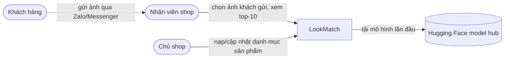
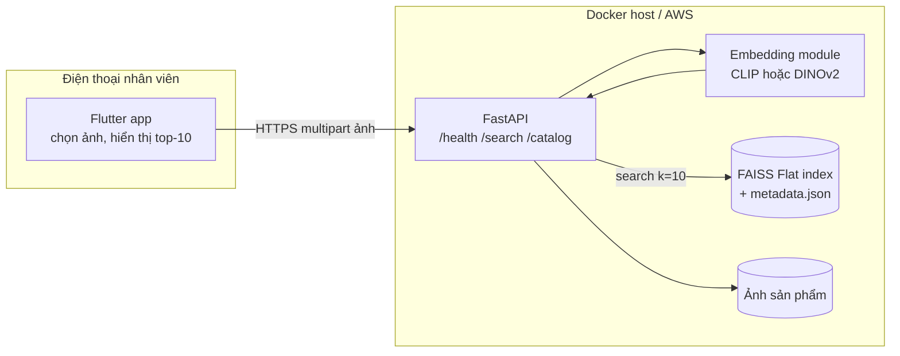

# Kiến trúc LookMatch (C4 mức 1–2)

## Mức 1 – Ngữ cảnh hệ thống

## Mức 2 – Container

Luồng tìm: ảnh → resize → embedding (vector chuẩn hoá L2) → FAISS tìm 10 vector gần nhất theo cosine → trả mã sản phẩm + điểm + ảnh.
